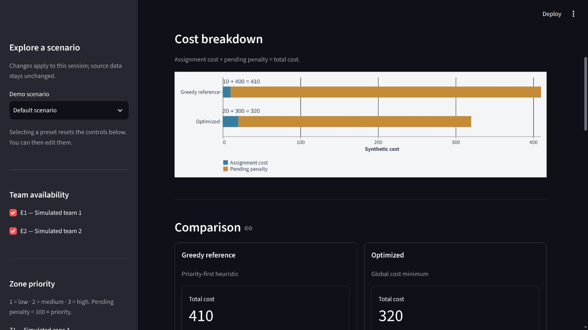

# FloodOps Lite

An interactive educational prototype for IEEE-HKN Hack2Impact 2026, focused on
resource allocation in a simulated flood-response scenario for Guayaquil, Ecuador.
It compares a greedy reference with an optimal assignment using the same inputs
and constraints. It is not a validated emergency-response system.

## The problem

When response teams are limited, assigning the cheapest available team to the
next high-priority zone can leave another zone without a compatible team.
This prototype makes that trade-off visible through a small, reproducible example.

## What you can explore

- Four simulated zones, two teams and three scenario presets.
- Editable team availability and zone priorities, applied to both methods.
- Assignment tables, pending zones, stacked costs and objective reduction.
- A dynamic explanation of decision changes and a schematic assignment view.

Changing a preset resets the controls; you can then edit them manually. The
schematic uses illustrative positions and assignment links, not real locations
or routes. If a chart cannot load, the metrics and tables remain available.



## Example results

All values below are **synthetic cost units**. Each total includes assignment
costs and penalties for zones left pending.

| Scenario | Greedy reference | Optimized | Objective reduction |
| --- | --- | --- | --- |
| Default scenario | 10 + 400 = **410** | 20 + 300 = **320** | **21.95%** |
| Limited resources | 8 + 600 = **608** | 8 + 600 = **608** | 0% |
| Priority shift | 10 + 200 = **210** | 10 + 200 = **210** | 0% |

In the default scenario, greedy assigns E2 to Z1 and E1 to Z2. The optimizer
assigns E1 to Z1 and E2 to Z4 instead. E2 is the only team compatible with Z4:
using it for Z1 leaves Z4 pending in the greedy result. Spending 10 more units
on assignments avoids 100 units of pending penalties, reducing the total by 90.

Limited resources makes E2 unavailable. Priority shift raises Z2 to priority 3
and lowers Z4 to priority 1. Both methods tie in these two presets; the app
does not report an improvement when their costs are equal.

## Run locally

Use Python 3.13. From a terminal on Linux or macOS:

```bash
git clone https://github.com/GakunnSkap/floodops-lite.git
cd floodops-lite
python3.13 -m venv --copies .venv
source .venv/bin/activate
python -m pip install -r requirements.txt
python -m streamlit run app.py
```

Open the address printed by Streamlit, usually <http://localhost:8501>.
Stop the server with Ctrl+C. No API keys, external datasets or inference
services are required. Internet access is needed to clone and install packages.

## Run the tests

From the repository directory, with the virtual environment activated:

```bash
python -m unittest discover -v
python -m pip check
```

The suite contains 54 tests covering data validation, constraints, presets,
controls, charts and explanations. The optimizer is also checked against an
independent exhaustive enumeration on 100 reproducible small scenarios.

## Model

**Total cost = assignment costs + penalties for pending zones.**

One round: each available team can serve at most one zone, and each zone can
receive at most one team. Incompatible pairs are forbidden. Zones may remain
pending and teams may remain unused. Priority ranges from 1 to 3; the pending
penalty is `100 × priority`. This is a model preference, not guaranteed service.

The greedy reference visits zones by decreasing penalty, breaking ties by zone
ID, and selects the cheapest free compatible team, breaking ties by team ID.
It assigns a compatible team even if its cost exceeds the avoided penalty.

The optimizer uses SciPy's `linear_sum_assignment`: one row per zone, columns
for available teams and dummy columns for pending zones. Real columns contain
assignment costs; dummy columns contain the zone's penalty. Incompatible pairs
use infinity. Leaving every zone pending always provides a finite solution.

`data.get_scenario()` returns a fresh dictionary with `simulated`, `zones`,
`teams` and `costs`. Cost rows follow team order and columns follow zone order;
`None` marks an incompatible pair. Validation requires nonempty zone and team
lists and the priority-to-penalty relationship above. Both methods leave their
input unchanged. Different assignments can share the same optimal objective.

## Limitations

All zones, teams, availability and costs are synthetic. The model omits travel
times, road closures, resource capacity, multiple rounds and uncertainty. It
does not predict floods, use live weather, calculate safe routes or measure
reductions in damage, casualties or response times. Results illustrate only
the stated mathematical objective.

## Tools and assistance

Python, [Streamlit](https://docs.streamlit.io/) and
[SciPy](https://docs.scipy.org/doc/scipy/reference/generated/scipy.optimize.linear_sum_assignment.html).
Charts use Vega-Lite through Streamlit; Pandas is installed as a Streamlit
dependency. No third-party datasets are included.

The participants define the concept and scope, make decisions and review the
results. Codex assisted with research and environment preparation before the
event, and with programming, checks and documentation during the hackathon.
